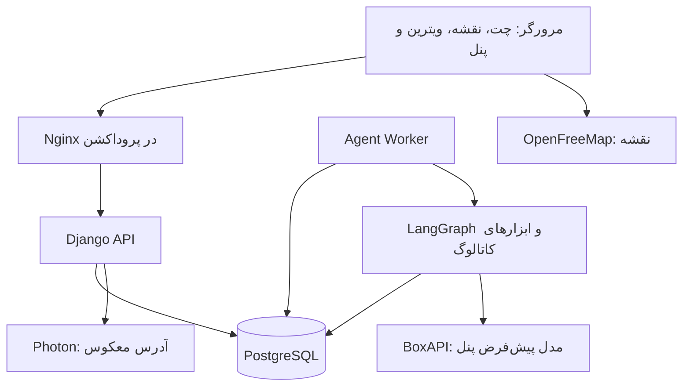

<div align="center">

# ترب همراه

### از یک گفت‌وگو تا خرید حضوری در تهران

**دستیار خرید مبتنی بر ایجنت · نقشهٔ تعاملی · مقایسهٔ محصول · ویترین فروشگاه**

[شروع سریع](#شروع-سریع-پس-از-دریافت-از-github) · [مستندات](docs/README.md) · [معماری](docs/architecture.md) · [عملیات و نگهداری](docs/operations.md)

</div>

---

## نسخهٔ آنلاین

[ورود به ترب همراه](https://t-hak-amirhosein.liara.run) · [پنل مدیریت](https://t-hak-amirhosein.liara.run/panel)

[راهنمای تحویل و داوری](docs/handoff.md) · [تاریخچهٔ تغییرات](CHANGELOG.md)

نسخهٔ PaaS با CLI لیارا منتشر شده است. دیتابیس و worker فعال‌اند؛ راهنمای تکرار انتشار در [مستندات CLI](docs/liara-cli.md) آمده است.

## این پروژه چه کاری انجام می‌دهد؟

ترب همراه برای چالش دستیار خرید حضوری هکاتون ساخته شده است. کاربر نیاز و بودجه‌اش را در چت بیان می‌کند؛ ایجنت از کاتالوگ ساختاریافتهٔ چالش محصول پیدا می‌کند، گزینه‌ها را مقایسه می‌کند و فروشنده‌های ثبت‌شدهٔ آن کالا را روی نقشهٔ تهران نشان می‌دهد. کاربر می‌تواند ویترین فروشگاه را بررسی کند، انتخاب‌ها را نگه دارد و متن استعلام قیمت و موجودی را آماده کند.

| بخش | کاری که برای کاربر انجام می‌دهد |
| --- | --- |
| گفت‌وگوی ایجنت | فهم نیاز، سؤال روشن‌کننده، جستجو و استفاده از ابزارهای کاتالوگ |
| کارت محصول | تصویر، مشخصات، قیمت ثبت‌شده، مشابه‌ها و دسترسی به فروشندگان |
| بودجه | بازهٔ پویا از قیمت‌های همان جستجو، ورود مبلغ دلخواه و حفظ پیش‌نویس پس از رفرش |
| مقایسه | جدول مشخصات و نمودار قیمت بر اساس دادهٔ موجود |
| نقشهٔ تهران | دریافت فروشگاه‌های محدوده، جستجوی زنده، انتخاب فروشگاه و نمایش گروه نتایج پیام |
| آدرس‌ها | نام کوتاه، نشانی، پلاک و واحد، انتخاب نقطه و تکمیل نشانی با آدرس معکوس؛ یک آدرس فعال |
| ویترین | محصولات یک فروشگاه، جستجوی متن و فیلتر دسته‌بندی |
| ذخیره‌ها | محصولات و فروشگاه‌ها در منوی یکپارچهٔ هدر |
| استعلام | آماده‌کردن متن قابل کپی و نمایش لینک رسمی موجود در داده |
| پنل اختصاصی | تنظیم اتصال BoxAPI، پروفایل مدل، تست اتصال و آماده‌سازی دانش |
| رابط | فارسی، RTL، تم روشن/تاریک، واکنش‌گرا، تاریخ شمسی و ساعت تهران |

## فناوری‌ها

نسخه‌های ثبت‌شده در سورس، مبنای نصب‌اند؛ برای نصب، از فایل‌های dependency و lock استفاده کنید.

| لایه | فناوری |
| --- | --- |
| وب | React 19.3.1، Vite 8.3.5، Tailwind CSS 4.3.3 و CSS اختصاصی |
| نقشه و نمودار | MapLibre GL، OpenFreeMap، ApexCharts، آیکون‌های SVG |
| بک‌اند | Python 3.13، Django 6.1.2، Gunicorn |
| ایجنت | LangGraph، ابزارهای محلی کاتالوگ، BoxAPI با رابط Chat Completions |
| داده | PostgreSQL 17، جداول مرتبط و ایندکس‌های جستجو |
| اجرا | Docker Compose، Nginx در نسخهٔ پروداکشن، Git |

## شروع سریع پس از دریافت از GitHub

### ۱. پیش‌نیازها و کلون

Git و Docker با Compose v2 نصب باشند. در ویندوز، Docker Desktop را در حالت Linux containers اجرا کنید. برای اجرای Docker نیازی به نصب جداگانهٔ Python، Node یا PostgreSQL روی میزبان ندارید.

سورس پروژه به‌صورت عمومی در GitHub قابل دریافت است؛ برای clone نیازی به دریافت کلید API یا حساب مدیریت نسخهٔ آنلاین ندارید.

```powershell
git clone https://github.com/amirhosseinpourmoshir/torob-challenge.git
cd torob-challenge
docker version
docker compose version
```

دریافت ZIP از GitHub هم ممکن است: آن را استخراج کنید و ترمینال را در پوشه‌ای باز کنید که `compose.production.yaml` داخل آن است. نسخهٔ ZIP تاریخچهٔ Git را ندارد؛ برای دریافت به‌روزرسانی، clone مناسب‌تر است.

### ۲. تنظیم محیط

در PowerShell:

```powershell
Copy-Item .env.example .env
```

در Linux/macOS:

```bash
cp .env.example .env
```

فایل `.env` را ویرایش کنید. حداقل این موارد باید مقدار واقعی محلی داشته باشند:

| متغیر | مقدار مورد نیاز |
| --- | --- |
| `POSTGRES_DB` | `torob_hakatoon` |
| `POSTGRES_PASSWORD` | رمز انتخابی دیتابیس |
| `DJANGO_SECRET_KEY` | رشتهٔ تصادفی مخصوص همین نصب |
| `PANEL_ADMIN_USERNAME` | نام اولین مدیر، مثلاً `admin` |
| `PANEL_ADMIN_PASSWORD` | رمز اولین مدیر با حداقل ۱۲ نویسه |
| `AI_BASE_URL` | آدرس پایهٔ HTTPS سرویس BoxAPI مطابق حساب شما |
| `AI_API_KEY` | کلید سرویس؛ فقط در بک‌اند |
| `AI_MODEL` | یکی از مدل‌های مجاز گفتگو، مثلاً `gpt-6-luna` |

آدرس پایه را از ارائه‌دهنده بگیرید؛ مسیر نهایی `/chat/completions` را به‌عنوان آدرس پایه وارد نکنید. جزئیات تمام متغیرها در [راهنمای تنظیمات](docs/configuration.md) آمده است. خالی بودن اتصال AI مانع استفاده از نقشه و کاتالوگ نیست، اما گفت‌وگوی مدل به اتصال معتبر نیاز دارد.

### ۳. قراردادن دیتاست

فایل‌های اصلی چالش جداگانه توزیع می‌شوند و داخل GitHub نیستند. ساختار لازم:

```text
dataset/
├── shops.csv
├── products.csv
└── offers.csv
```

کلون مخزن، دادهٔ نصب قبلی یا کلید API را منتقل نمی‌کند. برای نصب تازه، فایل‌ها را وارد کنید یا نسخهٔ پشتیبان دیتابیس را بازیابی کنید.

### ۴. اجرای نسخهٔ پروداکشن محلی روی پورت ۵۰۰۰

```powershell
docker compose -f compose.production.yaml up -d --build
docker compose -f compose.production.yaml ps
```

هنگام اولین build، دانلود imageها و dependencyها زمان می‌برد. backend پس از آماده‌شدن PostgreSQL، migration، جمع‌آوری static و ساخت اولین مدیر را انجام می‌دهد. worker بعد از سالم‌شدن backend شروع می‌شود.

| نشانی | کاربرد |
| --- | --- |
| http://localhost:5000 | برنامهٔ اصلی |
| http://localhost:5000/panel | پنل اختصاصی مدیریت |
| http://localhost:5000/agent-ui | نمایشگاه ۳۰ نوع کامپوننت؛ نمونه‌ها دادهٔ نمایشی‌اند |
| http://localhost:5000/api/health/ | وضعیت سلامت بک‌اند |

فقط پورت عمومی ۵۰۰۰ باز می‌شود؛ دیتابیس و بک‌اند در شبکهٔ داخلی Docker هستند. برای محدودکردن دسترسی به همین رایانه، `SERVER_BIND=127.0.0.1` را در `.env` قرار دهید.

### ۵. ورود داده و آماده‌سازی اتصال

```powershell
docker compose -f compose.production.yaml exec backend python manage.py import_torob --path /dataset
docker compose -f compose.production.yaml exec backend python manage.py audit_catalog
```

ورود داده دستی است و با هر بار اجرا تکرار نمی‌شود. روی دیتابیس قبلیِ همین دستگاه، داده‌ها در volume می‌مانند. [جزئیات ورود و قواعد داده](docs/catalog.md) را برای رفتار اجرای مجدد ببینید.

در `/panel` با حساب مرحلهٔ دوم وارد شوید، اتصال و مدل پیش‌فرض گفتگو را بررسی کنید و «تست اتصال» را بزنید. این تست از اعتبار API استفاده می‌کند. در تب دانش ایجنت، آماده‌سازی محلی و ترجمهٔ ذخیره‌شونده را در صورت نیاز اجرا کنید.

### ۶. اولین مسیر استفاده

1. از هدر، آدرس تهران و نقطهٔ دقیق خود را ثبت و فعال کنید.
2. در چت بنویسید: «هدفون انکر تا ۵ میلیون برای موسیقی می‌خوام».
3. اگر سؤال یا بودجه نمایش داده شد، همان مرحله را پاسخ دهید.
4. مشخصات و مشابه‌ها را باز کنید؛ دو محصول را مقایسه کنید.
5. فروشنده‌ها یا دکمهٔ «دیدن فروشگاه‌ها روی نقشه» را بزنید.
6. ویترین فروشگاه را ببینید و برای تأیید قیمت و موجودی، متن استعلام آماده کنید.

## انتشار با CLI لیارا

برای اجرای PaaS از [راهنمای CLI لیارا](docs/liara-cli.md) استفاده کنید. فایل `Dockerfile.liara` مخصوص یک برنامهٔ Docker با فرانت، بک‌اند و worker است؛ PostgreSQL مقصد جدا تنظیم می‌شود. متغیر `LIARA_TEAM_ID` در `.env` برای انتخاب صریح تیم است. Compose محلی و کلیدهای آن به‌صورت خودکار به لیارا منتقل نمی‌شوند.

## اجرای توسعه

نسخهٔ توسعه bind mount سورس و Vite دارد. دو فایل Compose را هم‌زمان اجرا یا با هم ترکیب نکنید؛ هر دو نام پروژه و volume دیتابیس یکسان دارند.

```powershell
# اگر نسخهٔ پروداکشن در حال اجراست، اول آن را بدون حذف volume متوقف کنید.
docker compose -f compose.production.yaml down
docker compose up -d --build
docker compose exec backend python manage.py bootstrap_panel
```

رابط روی پورت ۵۰۰۰، بک‌اند روی ۸۰۰۰ و PostgreSQL محلی روی ۱۵۴۳۲ است. تغییر فرانت با Vite نمایش داده می‌شود؛ پس از تغییر کد worker، `docker compose restart agentworker` را اجرا کنید. دستورهای واردکردن دیتاست همان‌اند، فقط `-f compose.production.yaml` را حذف کنید.

## معماری در یک نگاه



چت درخواست را ثبت می‌کند و وضعیت نوبت را از API می‌گیرد. worker کار را اجرا می‌کند و نتیجهٔ ساختاریافتهٔ معتبر را می‌نویسد. رابط با قرارداد کامپوننت‌ها آن را نمایش می‌دهد. [نقشهٔ فایل‌ها و جزئیات معماری](docs/architecture.md) توضیح می‌دهد هر بخش کجا قرار دارد.

## بررسی و نگهداری

```powershell
docker compose -f compose.production.yaml exec backend python manage.py check
docker compose -f compose.production.yaml exec backend python manage.py test --noinput
docker compose -f compose.production.yaml exec backend python manage.py makemigrations --check --dry-run
docker compose run --build --rm --no-deps frontend npm run test:agent-ui
docker compose run --build --rm --no-deps frontend npm run build
```

در آخرین بررسی کد، ۷۰ تست بک‌اند و ۶ تست قرارداد کامپوننت‌ها موفق بودند. گفت‌وگوی واقعی، بودجه پس از رفرش، توقف، فیلتر ویترین و نمایش گروهی نقشه در دسکتاپ/موبایل هم بررسی شدند. این بررسی‌های مرورگری اجراهای دستی/ابزاری‌اند و مجموعهٔ خودکار کامل end-to-end داخل مخزن نیستند.

برای log، به‌روزرسانی، توقف، پشتیبان‌گیری و رفع خطاها به [راهنمای عملیات](docs/operations.md) مراجعه کنید. `docker compose ... down` داده را نگه می‌دارد؛ **`down -v` volume دیتابیس را حذف می‌کند**.

## حدود واقعی قابلیت‌ها

- قیمت و موجودی دیتاست، تأیید امروز فروشنده نیست. استعلام فعلی متن آماده و لینک رسمی می‌دهد؛ تماس یا پیام خودکار ارسال نمی‌کند و اینستاگرام را نمی‌خواند.
- فروشگاه به‌تنهایی قیمت ندارد؛ قیمت به پیشنهاد فروش همان محصول مربوط است. نمودار، تخفیف، تاریخچه و امتیاز بدون داده ساخته نمی‌شوند.
- جستجو روی PostgreSQL و قواعد متن/برند/مدل است؛ فعال‌بودن پروفایل embedding به معنی اجرای جستجوی برداری نیست.
- فاصلهٔ داخل رابط مستقیم است. مسیریابی خیابانی با لینک بیرونی باز می‌شود.
- نام‌ها و شماره‌های مصنوعی دیتاست محدودیت منبع‌اند؛ شماره‌های مصنوعی منتشر نمی‌شوند. اختلاف قیمت نشانهٔ بررسی بیشتر است، نه اثبات قطعی اصالت یا تقلب.
- آدرس‌ها و گفتگو به نشست مرورگر وابسته‌اند؛ حذف cookie یا مرورگر دیگر به معنی ورود به همان نشست نیست.
- توقف و مهلت پیش‌فرض ۹۰ ثانیه از انتظار نامحدود جلوگیری می‌کنند؛ سرعت پاسخ همچنان به سرویس مدل وابسته است.

## مستندات بخش‌ها

| راهنما | محتوا |
| --- | --- |
| [فهرست مستندات](docs/README.md) | مسیر مطالعه بر اساس نقش |
| [معماری](docs/architecture.md) | ساختار پوشه‌ها، مسئولیت‌ها و جریان درخواست |
| [تنظیمات](docs/configuration.md) | متغیرهای محیط و مدل‌های مجاز |
| [عملیات](docs/operations.md) | اجرا، به‌روزرسانی، backup، عیب‌یابی و بررسی ارائه |
| [ایجنت](docs/shopping-agent.md) | ابزارها، دانش فروشندگی، توقف، بودجه و API |
| [کاتالوگ](docs/catalog.md) | مدل داده، import و کیفیت اطلاعات |
| [نقشه](docs/shop-map.md) | جستجو، محدودیت زوم و فروشگاه‌ها |
| [پنل](docs/admin-panel.md) | اتصال، حساب مدیر و پروفایل مدل |
| [کامپوننت‌ها](docs/agent-ui.md) | قراردادها، رویدادها و نمایشگاه |
| [CLI لیارا](docs/liara-cli.md) | احراز هویت، تیم، بستهٔ Docker و انتشار PaaS |
| [میزبانی](docs/hosting.md) | پیشنهاد اقتصادی لیارا و محدودیت ظرفیت |
| [همکاری](CONTRIBUTING.md) | بررسی، کامیت فارسی و روال Git |

نسخهٔ آنلاین روی لیارا اجرا می‌شود. تغییر سورس و push بعدی به GitHub به‌تنهایی نسخهٔ آنلاین را به‌روزرسانی نمی‌کند؛ انتشار با CLI جداگانه انجام می‌شود. مخزن، فایل محیطی، دیتاست خام، دیتابیس و کلیدها را شامل نمی‌شود.
